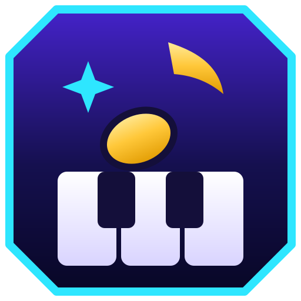
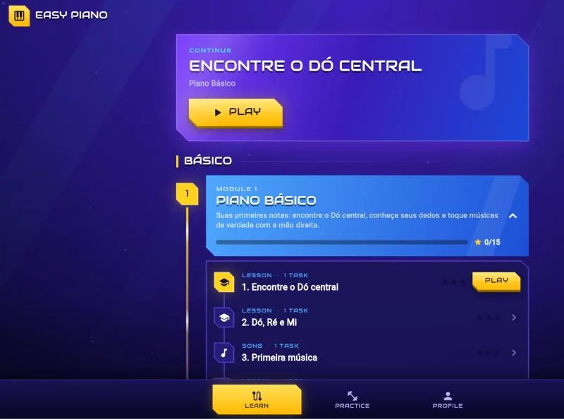
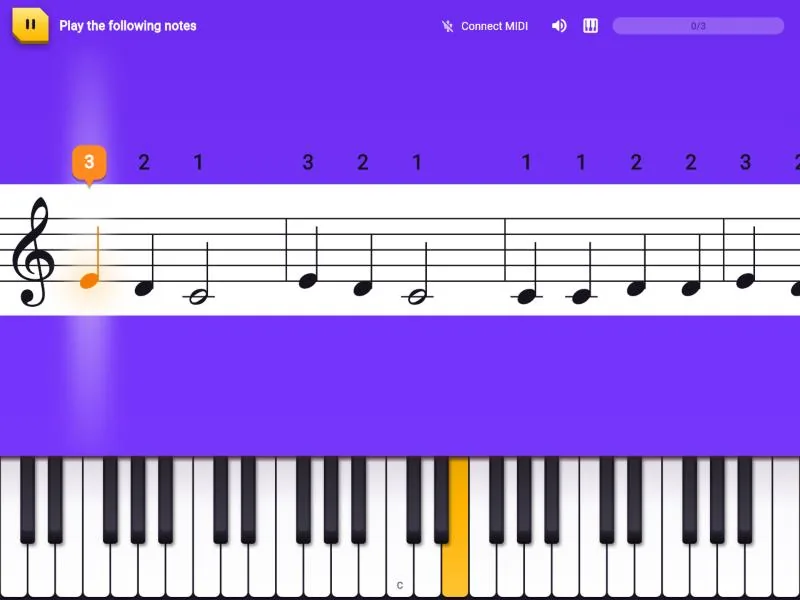
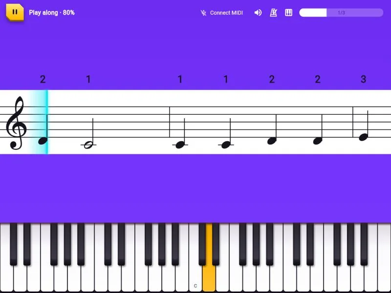
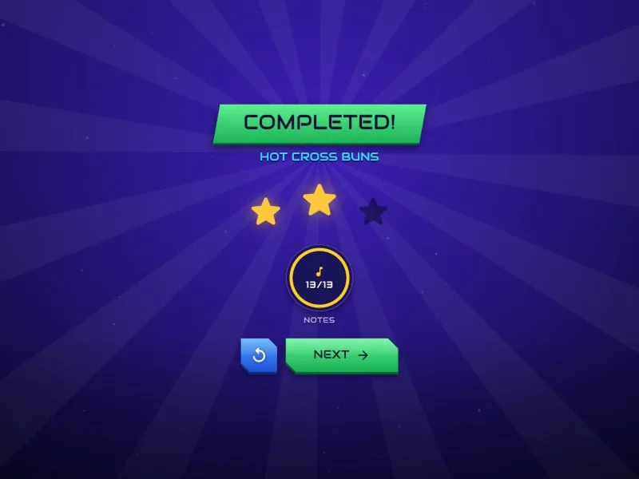

<p align="center">
  
</p>

<h1 align="center">Easy Piano</h1>

<p align="center"><strong>A free, open-source piano course that feels like a game.</strong></p>

<p align="center">
  <a href="https://easy-piano.pages.dev/"><strong>▶ Play it now at easy-piano.pages.dev</strong></a><br>
  <sub>Runs in Chrome or Edge on desktop; plug in a MIDI keyboard or use the on-screen keys.</sub>
</p>

Plug in a MIDI keyboard (or tap the on-screen keys), pick a lesson, and play. Easy Piano waits for the right note, scores your timing, and hands out stars as you work through short, bite-sized lessons on a course map. Every song in it is public domain or our own arrangement, so the whole thing can be shared, forked and improved.

<p align="center">
  
</p>

## Screenshots

| Wait mode | Play-along |
|---|---|
|  |  |

<p align="center">
  
</p>

## Features

- **Course map** of short lessons, with stars tracking your progress.
- **Wait mode**: the music waits for you to find the note. No pressure.
- **Play-along**: play in time as the score moves, with an optional metronome; timing is graded on every note.
- **Stars** after every lesson, so you always know what to replay.
- **MIDI keyboards** over Web MIDI, or the on-screen keyboard with mouse or touch.
- **Real piano sound** and a pre-listen so you hear the tune before you play it.
- **Clean content**: original lessons and public-domain songs, each with license metadata checked in CI.

## Try it

A hosted web build is coming soon. Until then, run it locally (needs [Flutter](https://docs.flutter.dev/get-started/install), [Rust](https://rustup.rs) and [`flutter_rust_bridge_codegen`](https://cjycode.com/flutter_rust_bridge/)):

```bash
python tools/sync_content.py
cd app
flutter_rust_bridge_codegen build-web --release
flutter build web --release
cd ..
python tools/serve_web.py
```

Then open <http://localhost:8765> in Chrome or Edge (Web MIDI works best there). `serve_web.py` adds the cross-origin headers the Rust/WebAssembly core needs, so a plain static server won't work.

## How it's built

| Part | Tech |
|---|---|
| App (web first; Android, iOS, desktop later) | Flutter, in [`app/`](app/) |
| Timing, grading, notation parsing | Rust, in [`core/`](core/), shared with the app via flutter_rust_bridge |
| Lessons and songs | JSON + compact note text, in [`content/`](content/) |
| Content checks | [`tools/content-cli/`](tools/content-cli/) |

More in [docs/ARCHITECTURE.md](docs/ARCHITECTURE.md).

## Status

Early and moving fast: Phase 1 (first playable) is in progress. The first Piano Basics lessons, wait mode, play-along, piano sound and the course map work today. See the [roadmap](docs/ROADMAP.md) for what's next, and [docs/README.md](docs/README.md) for the full project docs.

## Contributing

Ideas, bug reports and pull requests are welcome. Before you start:

- Read [AGENTS.md](AGENTS.md) for project conventions (it's written for AI agents, but applies to humans too).
- Tasks are tracked as [beans](https://github.com/hmans/beans) in [`.beans/`](.beans/).
- Content must be clean: only original or public-domain material. See [content and licensing](.agents/rules/content-and-licensing.md).
- Run `cargo test` in `core/` and `cargo run -- lint ../../content` in `tools/content-cli/` before opening a PR.

## License

- **Lessons and songs:** [CC BY-SA 4.0](https://creativecommons.org/licenses/by-sa/4.0/).
- **Code:** open-source license being finalized (MPL-2.0 proposed; see [open questions](docs/OPEN-QUESTIONS.md)).
